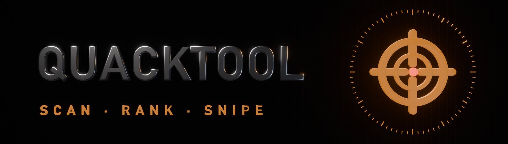

<p align="center">
  
</p>

<p align="center">
  <a href="https://x.com/lumecather"></a>
  <a href="https://quacktool.com"></a>
  
</p>

---

### 🎯 Now building

<a href="https://github.com/lumecather/quacktool">
  
</a>

**[QuackTool](https://github.com/lumecather/quacktool)** — an NFT sniper bot for reveals. It watches a collection,
scans every token the moment the metadata goes live, ranks them by rarity and buys the rare cheap ones by the
user's rules.

```text
> one asyncio engine for every user      > Django · Channels · Redis
> rarity ranks from the full metadata    > Ethereum + Robinhood Chain
> reveal monitoring · auto-buy rules     > 650+ automated tests
```

→ **[How it works](https://github.com/lumecather/quacktool)** · **[Try it free](https://quacktool.com)**

---

### 🧰 Stack

<p>
  
</p>

- **Backend:** Python, Django, DRF, Channels (WebSockets), Celery, asyncio / aiohttp
- **Web3:** Solidity, web3.py, Ethereum & L2s, OpenSea API / Seaport, IPFS, Sign-In with Ethereum
- **Infra:** PostgreSQL, Redis, Docker Compose, nginx, AWS Lightsail

---

<p align="center"><sub>Backend · Python · Solidity · Web3 — DMs are open on <a href="https://x.com/lumecather">X</a>.</sub></p>
